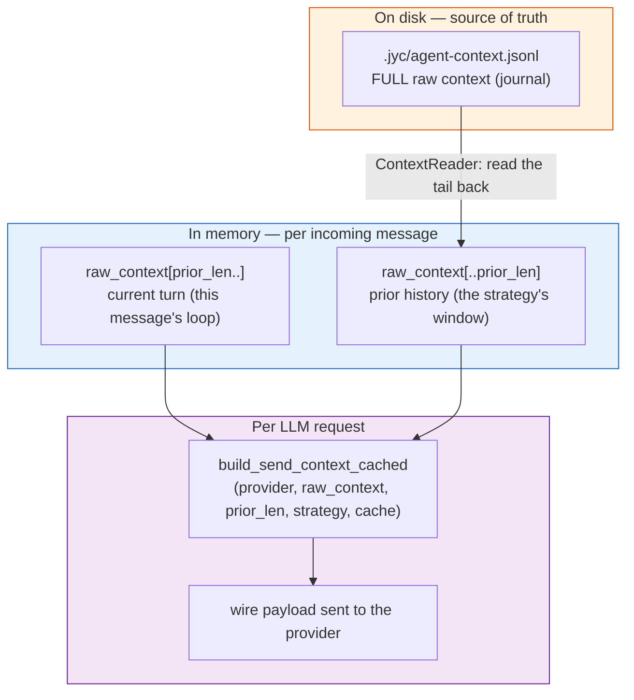
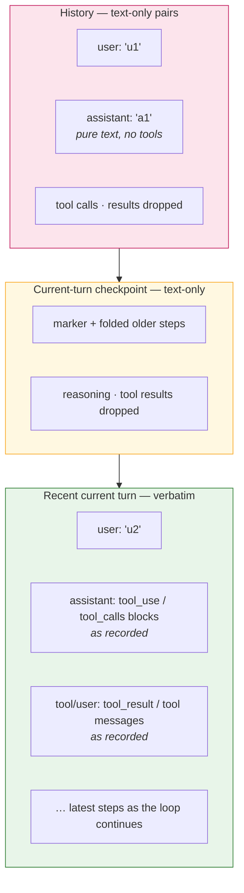
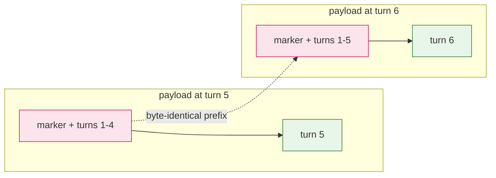

# Context Management

How JYC decides what the LLM sees on each request: context strategies,
turn pairing, the shape of the resulting wire payload, and the token-level
safety nets that prevent context overflow.

## Overview

Three core principles govern the whole system:

1. **The raw context is the source of truth.**
   `.jyc/agent-context.jsonl` (append-only journal, one message per line) stores the full conversation (including tool
   calls and results) exactly as recorded. Strategies never reshape this
   file — only a session reset (manual `/reset`) clears it. The journal
   is read back **backwards, in blocks** (see
   [Reading the prior back](#reading-the-prior-back)): only the window
   the strategy needs is parsed, so a journal that grew to hundreds of
   megabytes costs the same per turn as a small one.
2. **Only the wire payload is shaped.** Every LLM request passes through
   `build_send_context_cached()` (`crates/jyc-agent/src/agent_loop/context.rs`),
   which decides what slice of the raw context to send and in what form.
3. **The strategy keeps the request inside the budget.** The anchored
   sliding window grows by whole turns and slides — drops whole turns off
   its head — when it outgrows `max_window` turns, or on weight
   (`max_history_tokens`) at the top of that cycle; there is no separate
   token monitor that compresses or resets the session underneath it.
4. **The system prompt is unchanged by runtime churn; volatile state
   rides the turn.** Every LLM call re-sends the whole prefix, and
   providers that cache by prefix only reuse what did not change, so the
   system prompt holds only content that changes when config or files do
   — the one exception being the access boundary's grant lines, which
   have to track what the tool layer enforces. Runtime state that moves
   while the instance runs — the subagent roster and the channel/topic
   roster — is built by `build_turn_reference()`
   (`crates/jyc-agent/src/service/prompt.rs`) and prepended to the
   current turn's user message inside a `<runtime-state>` block, framed
   as an auto-generated snapshot. That block sits past the cached
   prefix either way (the user message is new every turn), so topics
   appearing and closing no longer invalidate the system prompt's cache
   entry. The per-turn `prompt_hash` on the `System prompt built` trace
   line is the regression tripwire. Layout diagrams:
   [DESIGN.md §8](../../DESIGN.md).

## Data Plane



`prior_len` is the length of the raw context at the moment the incoming
message was received. Everything after it — the new user message, the
assistant's intermediate steps, tool calls, tool results — is the
**current turn**. Its most recent interaction is sent verbatim so
tool_use/tool_result pairing stays valid mid-loop; once a turn passes
`checkpoint_interval` assistant steps (default 32), the older part folds
into a text-only checkpoint, the same shape as prior-turn history. Each
further checkpoint is wider than the last (`checkpoint_growth`, default 8:
32, 36, 40 … assistant steps), so a long turn keeps a growing verbatim
tail.

### Reading the prior back

`crates/jyc-agent/src/context_reader.rs` owns the journal's read side.
The journal is append-only, so the reader never needs the whole file: it
walks **backwards** from the end in 64 KB blocks, parses the lines it
finds and hands out the window the caller asked for.

- **The unit is the turn, not the message.** A turn opens at a
  text-bearing user message; a *pair* is a turn that produced an
  assistant reply. The two counts differ (an unanswered user message is
  an opener without a pair), and the strategies read both kinds.
- **`full` mode reads everything; `sliding_window` reads forward from
  the anchor.** `session::load_context` reads the journal **forward**
  from `agent-session.json`'s `context_offset` (`ContextReader::read_from`),
  attaching each message's line-start offset so a slide can advance the
  anchor without re-scanning. The read amount is bounded by how far the
  window has grown — `max_window` turns (and optionally
  `max_history_tokens` weight) keep it small.
- **The slice starts at a turn boundary.** A cold start (no anchor, or
  one that no longer lands on a turn opener) reads from the journal's
  head once. It slides only when that read exceeds `max_window` turns,
  and that slide is what persists the new anchor; a journal that fits
  keeps no anchor at all (see below).
- **Dangling tool calls are repaired on the way out.** The slice drops
  an assistant message whose tool calls have no tool result, and
  everything after it, as the whole-file load path did. The repair
  cannot wait for the wire: there it would also drop the current turn,
  which sits after the dangling message.
- **The pair count stays warm.** The reader keeps how many pairs the
  journal holds in process, keyed by the journal's length and mtime, and
  the writer adds to it as it appends. A turn that changes nothing on
  disk costs a `stat`, not a full count.
- **A torn tail is repaired or dropped.** A crash mid-append can leave a
  partial last line. When it is a complete message that lost only its
  newline — the usual shape, the write was cut at its last byte — it is
  kept, and the next append terminates it. A partial line is dropped
  instead. Either way the history in front of it is untouched: the cut
  point is found by scanning back for the last newline, and an
  unreadable journal (the scan fails) is left alone rather than
  truncated.
- **A corrupt line ends the backward scan**: the newer turns stay, the
  older ones are not trusted. This is the inverse of the whole-file
  parser, which kept the older prefix — with a backwards scan the newer
  turns are the ones already parsed.

The write side is append-only too: a turn's messages are appended at the
end of the file (`session::save_raw_context`), and nothing before them
is touched.

## Context Strategies

Configured via `context_strategy` (see [Configuration](#configuration));
changeable at runtime with the `/context` command.

### `full`

Sends the entire raw context on every request — `build_send_context_cached`
returns `Cow::Borrowed`, a zero-copy borrow. Simple, accurate, and grows
linearly with conversation length until a token safety net fires.
Not the default — opt in via `context_strategy = { mode = "full" }`.

### `sliding_window`

Anchored, not per-turn sliding. The session state
(`agent-session.json` in the state dir) persists one number —
`context_offset`, the journal byte offset where the window's oldest
retained turn begins — and each load reads the journal **forward** from
there:

1. **History, text-only** — every prior turn in the window
   as a user/assistant text pair, reformatted in the active provider's
   wire format. Their tool calls, arguments and results are dropped from
   the payload (the journal keeps them; `context_browse` reads the turns
   and their calls back, without results).
   This block only ever **grows**: nothing trims its head.
2. **Current-turn checkpoint, text-only** — after `checkpoint_interval`
   assistant steps (default 32), the older steps fold into one checkpoint
   in that same text-only shape, with a marker. It contains the turn's
   opening user message and the folded assistant conclusions; older
   reasoning and tool results leave the wire exactly as they do for prior
   turns. Each later checkpoint is wider by `checkpoint_interval /
   checkpoint_growth` steps (default 32 / 8 = 4), so the verbatim tail
   grows with the turn.
   The boundary advances one checkpoint at a time, so the checkpoint
   changes at most once per checkpoint.
3. **Recent current turn, verbatim** — from the first assistant step
   after the checkpoint to the end of `raw_context`, untouched, tool
   calls and results included, so the loop's `tool_use` ↔ `tool_result`
   pairing stays legal mid-flight and provider-specific replay fields
   survive where they matter.

`window` (default `10`) is the number of turns the window keeps after a
slide. `extend_rate` (default `0.5`) is how far it may grow first:
`max_window = window + round(extend_rate × window)` = 15 turns. The
window grows by pure append until it holds more than `max_window` turns,
then **slides**: the anchor moves forward so the last `window` turns
remain, whole turns at a time (never splitting a `tool_use` from its
`tool_result`). `extend_rate = 0` makes `window` a hard cap that slides
on every turn.

A load with no anchor — fresh topic, `/reset`, an upgraded session file,
or an offset that no longer lands on a turn boundary — cold-starts: the
journal is read from its head once and the anchor is **dropped** (a window
that covers the whole journal needs none; leaving a bad offset in place
would repeat the cold start and its warning every turn). The first slide
persists a new one, and every load after that is bounded by the window.

The anchor is the whole point: providers cache by **prefix**, so the
payload should grow only at its tail between slides. The history does
exactly that, so the history block is append-only — the cached prefix
reaches all of it, and only the turn that just ended plus the current
turn are re-encoded. Nothing trims the window's head in between — an
earlier design trimmed the history to a token budget on *every* turn, and
since that trim could never actually reduce the total below the budget,
the head advanced on every turn and the cross-turn prefix broke on every
first call (production wire dumps showed the history block collapsing to
a bare marker, cache hit ~0). One dropping mechanism, driven off turn
count, with hysteresis — not a per-turn fitter.

#### What a request looks like

One request with six prior turns (t1…t6) and turn 7 in flight. Nothing
else is in `messages`: prior history and the folded checkpoint are
text-only, and only the recent current turn carries tool calls.

```
POST /v1/messages
 model      "deepseek-chat"                       <- no history
 system     "You are jyc, running in a topic..."   <- no history
 tools      [ bash, read, write, edit, grep, ... ] <- no history
 messages   |

 0  user        "[History messages] earlier conversation follows - text-only,
                 tool calls/results omitted."
                 -- only added when the history block is non-empty

 1  user        t1: what the user said
 2  assistant   t1: the reply text                         |  history block
 3  user        t2: what the user said                     |
 4  assistant   t2: the reply text                         |  t1-t6 fold to text:
 5  user        t3: what the user said                     |  their tool_calls,
 6  assistant   t3: the reply text                         |  tool messages and
 7  user        t4: what the user said                     |  results are dropped
 8  assistant   t4: the reply text                         |
 9  user        t5: what the user said                     |
10  assistant   t5: the reply text                         |
11  user        t6: what the user said                     |
12  assistant   t6: the reply text                         |

13  user        "turn 7"                                  -- current turn
    ...         checkpoint marker + folded older steps       (only after the
                                                             checkpoint interval)
14  assistant   "..." + tool_calls[bash(...)]              -- recent suffix,
15  tool        the full tool result                       -- verbatim
16  assistant   "..."                                      -- turn cap applies
```

Two properties follow from that shape, and both are what the design is
for:

- **The history block is a byte-stable prefix from one turn to the next.**
  Turn k+1's history is turn k's history plus that turn's own pair:
  nothing before it is rewritten, so the provider's cache carries.
- **Only the recent current turn is structured.** A prior turn's tool calls
  are never replayed, and neither are the current turn's once they age
  past a checkpoint, so an old result cannot look like something the model
  is still working on — and `context_browse` is where the turns and their
  calls are read back.





The history block is built **once per turn**, not once per LLM call: it depends
only on `raw_context[..prior_len]`, which is fixed while a turn runs
(injections append after it; the one shrink — a cancellation truncation —
ends the turn). `SendContextCache` (keyed on that split point) holds it
for the turn's remaining calls; the log's `history_rebuilt` says whether a
call rebuilt it (`rebuilt`), reused it (`reused`), or built nothing at all
(`-`, `full` mode).

The current-turn checkpoint is cached the same way, keyed on its absolute
end index. Its boundary is derived from the number of assistant messages,
so a cold build and a warm cache produce the same payload. It advances
once per checkpoint — `checkpoint_interval` steps for the first, then each
wider by `checkpoint_interval / checkpoint_growth`; between advances the
log's `checkpoint_rebuilt` says `reused`, and at a boundary it says
`rebuilt` (`-` means no checkpoint is active).

The journal still holds each turn's raw messages, tool calls and results
included — nothing is lost, it is just not replayed. `context_browse` is
the way back to them, and it renders each turn's calls on its own
`[n] TOOLS:` line.

#### Turn pairing (`extract_pairs`, `crates/jyc-agent/src/session.rs`)

The pairing unit is the **turn**, not the single message:

- A **text-bearing user message opens a turn**; the next one (or end of
  context) closes it.
- **All assistant messages in a turn are merged into one entry** holding
  only their visible text — intermediate tool-call steps and the final reply
  alike. The separate `reasoning_content` field, one leading inline block
  that duplicates it, and `tool_calls` are stripped from the assistant
  entry, so the history block carries neither reasoning nor call structure.
  A block-shaped leading string without that field is preserved as visible
  text.
- **The turn's tool calls are collected separately** (`TurnPair::tool_calls`,
  one `name(args)` string per call — at most 20 per turn, the rest counted
  in `TurnPair::omitted_tool_calls` and rendered as `…(N more calls)`) for
  the transcript view; they never enter the assistant's own text and never
  reach the wire.
- **Anthropic `tool_result` user-role wrappers** carry no text, so they
  don't open turns.
- Assistant messages seen before any user message are dropped; a trailing
  turn with no assistant reply yet produces no pair (a fallback keeps the
  last user message when no pairs exist at all).

#### Anthropic compatibility defenses

- Synthetic user/assistant messages are built via the active provider's
  own formatter (`format_user_message` / `build_raw_assistant_message`),
  so both `content: "..."` (OpenAI-compat) and `content: [...]`
  (Anthropic) shapes stay valid.
- **Empty text blocks are never emitted** — messages with no extractable
  text are skipped, because Anthropic rejects empty blocks, especially
  under `cache_control`.
- **A journal written on another provider is normalized before it is
  sent.** The journal stores the *active* provider's wire format, so after
  a `/model` switch the history still holds the other family's messages.
  Both send paths convert them: `openai_compat` / `openai_responses` call
  `anthropic_to_chat_messages`, and `AnthropicProvider::complete_raw`
  calls `chat_to_anthropic_messages` (`tool_calls` → `tool_use` blocks,
  `role:"tool"` → a `tool_result` block in a user turn, chat text/image
  parts → `text`/`image` blocks, `reasoning_content` dropped, empty
  content dropped). Without the second direction a topic switched from an
  OpenAI-family model could not answer at all: the Messages API rejects
  `tool_calls` / `role:"tool"` outright (`messages.N … INVALID_REQUEST_BODY`).
  Conversion is per request — the journal is never rewritten — and both
  directions leave messages already in the target shape untouched, so a
  journal that switched back and forth stays valid.

## Debug dump: `/context dump on|off`

For inspecting what the model actually sees — useful when a model
"hallucinated a tool call I never made" or when a windowing decision
seems off — every LLM call in a topic can be appended as one JSON line
to:

```
<topic_path>/.jyc/wire-payload.jsonl
```

Toggle with the `/context` command:

| Command | Effect |
|---------|--------|
| `/context dump on` | Write `.jyc/wire-payload-dump.json` flag; dump starts on next LLM call |
| `/context dump off` | Remove the flag; no further dumps |
| `/context dump` | Show current state + dump file path |

Each line of `wire-payload.jsonl` is one JSON object:

```json
{
  "ts": "2026-08-24T12:34:56.789Z",
  "iter": 3,
  "strategy": { "mode": "sliding_window", "window": 10 },
  "regions": [1, 1, 1, 1, 2],
  "wire_payload": [ ... ]
}
```

`regions` is a parallel `Vec<u8>` to `wire_payload`: `1` = text-only
history, `2` = recent current turn verbatim, `3` = folded current-turn
checkpoint. `1` for `Full` mode means "one block, no windowing". Use it to
partition the payload when reconstructing what each LLM call looked like.

**Bounded footprint.** The file is capped at the **last 50 lines**
(oldest dropped). For a 12-message payload at ~10 KB per call this
stays under ~500 KB even across many iterations — small enough to
diff between iterations with `git diff` or pipe through `jq`.

The flag file (`wire-payload-dump.json`) survives `/reset`, `/new`, and
`/close` — disable it explicitly when you're done. Best-effort IO:
write errors are logged at `warn` and never propagated (a broken dump
must not break the agent loop).

For an in-process, human-readable view of a single wire payload (with
a box around each part), call `dump_send_context` from a test or via
the `crates/jyc-agent/src/agent_loop/context.rs` API. It uses the same
`build_send_context_with_regions` (a cold build: it delegates to
`build_send_context_cached` with a throwaway cache) so the labels are
identical.

## Recovering dropped turns: `context_browse`

Turns that fall out of the window are not gone — they remain in the
journal on disk. The built-in `context_browse` tool pages through the
full transcript (shared `extract_pairs` view):

- `offset` — pairs to skip from the **newest** end (0 = most recent).
- `limit` — page size (default 10, max 50).
- Returns numbered `USER:` / `ASSISTANT:` lines, oldest→newest within the
  page.
- Reads the older turns back from the journal (the reader parses only
  the tail the page needs) and takes the running turn from memory —
  the journal does not have it yet.

The system prompt tells the agent to use `context_browse` whenever it
needs earlier turns of the current conversation.

## Token safety nets

Two triggers, one action. The window slides (anchor forward, whole turns
dropped, back to `window` turns) when it holds more than `max_window`
turns, and — only at the top of that extension cycle, where the turn bound
is about to fire anyway — when its estimated weight exceeds
`max_history_tokens`. A window below `max_window` turns never slides on
budget alone: a window whose `window` turns already exceed the budget
cannot get under it, and chasing it every turn would move the anchor on
every turn.
The slide is the only way **history** shrinks; nothing trims between slides,
which is what keeps the wire prefix byte-stable and the provider cache
alive. The current turn has its own two bounds — `turn_tool_result_cap`
per result, and a checkpoint every `checkpoint_interval` assistant steps
(default 32) that folds older steps into the text-only form — but neither
moves the history head, and the checkpoint intervals widen
(`checkpoint_growth`), so the current turn's bound grows with the turn.
`full` mode grows verbatim until the provider's own limit; it has no
checkpoint and no history window. A session reset (`/reset`) clears the
context outright; it does not summarize or compact it.

The context-window figures the dashboard and `/info` show come from the
same place: the most recent LLM call's `usage.input_tokens` plus that
call's `usage.output_tokens` — the size of the context the *next* call
will carry — against the model's context window.

## Configuration

```toml
# Global default for all channels/topics
[ai]
context_strategy = { mode = "sliding_window", window = 10, extend_rate = 0.5 }

# Per-pattern override (takes priority over [ai])
[channels.jyc_repo.patterns."**"]
context_strategy = { mode = "full" }
```

`mode` accepts `full` or `sliding_window` (alias `sliding`; default).
The window fields count **turns**; `checkpoint_interval` and
`checkpoint_growth` count **assistant messages and folds** (see their
rows):

| Field | Default | Meaning |
|-------|---------|---------|
| `window` | `10` | Turns kept after a slide — the window's floor |
| `extend_rate` | `0.5` | Growth allowed before a slide: `max_window = window + round(extend_rate × window)`; `0` = hard window (slides every turn) |
| `turn_tool_result_cap` | unset | Per-result byte cap on the recent current-turn suffix — see below |
| `max_history_tokens` | unset | Second slide trigger, at the top of the extension cycle — see below |
| `checkpoint_interval` | `32` | Completed assistant messages before the current turn's older steps fold into a text-only checkpoint; `0` disables folding — see below |
| `checkpoint_growth` | `8` | Folds per widening step: each checkpoint is `checkpoint_interval / checkpoint_growth` steps wider than the last, so a long turn keeps a growing verbatim tail; `0` keeps the interval fixed — see below |

## `turn_tool_result_cap` — bounding the current turn

The current turn's **recent suffix** is uncapped by default: the model is
mid-reasoning over those
tool results, and silently trimming what it is still working through is
the more damaging failure. The cost is that one verbose result — a
`read` of a large file, a chatty command — rides every remaining call
of the turn, at full price each time. The per-result cap below bounds
one result; the checkpoint bounds how many old results remain on the
wire at all.

`turn_tool_result_cap: N` opts into a size bound on the recent suffix
(nothing else bounds those results — the window bound is history-only and
the checkpoint already dropped the older steps' results). An oversized
result keeps its **head and tail** with the middle replaced by

```
… [N bytes dropped from the middle — re-read with offset/limit to see the gap] …
```

Head-only truncation would hide what a result is usually read for: the
error at the bottom of a command's output, the totals of a grep. The
marker states how much is missing and how to page it, so the cost of
the cut is one extra tool call the model chooses to make. The cap counts
the marker **inside** `N` — the caller gets the byte bound it asked for.

| Value | Behavior |
|-------|----------|
| unset (default) | The recent suffix is sent in full. |
| `Some(0)` | Explicit "off" sentinel — same as unset. |
| `Some(N > 0)` | Each current-turn tool result keeps head + tail within `N` bytes total. A value below 130 cannot hold the drop marker plus both ends, so it is lifted to 130 rather than silently degrading to a head-only cut — the `/context` command refuses such a value instead, since there the user is present to be told. |

Both wire shapes are handled (string `content` in place, or
per-`tool_result`-block for Anthropic), and the cap is per result block,
not per turn — a turn with ten tool calls can still exceed `N` in total.

Set it from a command: `/context sliding 10 0.5 32768` (third
positional; `0` switches it off, omitting it keeps the configured
value, accepted range `0` or 130..1 MiB, and a sixth positional is
refused outright), or from config as
`context_strategy = { …, turn_tool_result_cap = 32768 }` — where a
non-zero value below 130 is lifted to 130 rather than rejected.

**History and checkpoints have no tool results to cap.** Both are
text-only, so the cap has nothing else to apply to: prior turns and the
folded older part of the current turn were folded without their results
in the first place.

**Why per-result, not global:** a single 5 KB `read` result is usually
fine; ten 100 KB results from one bash test suite are the actual
problem. Capping per-result gives both levers — keep individual
results readable while bounding the total. A global token budget on
the wire payload is a separate concern (`max_history_tokens`).

## Current-turn checkpoint — bounding verbatim replay

A turn is not bounded by `window`: its assistant steps accumulate until
the turn ends. The checkpoint bounds the **verbatim replay** of that
growth without an LLM summary and without moving the history prefix. It
is not a hard bound on the whole payload: the folded text still grows
with the turn's visible assistant text and retained user messages, but
older reasoning and tool-result payloads stop riding every call.

With `n` completed assistant messages in the current turn, the configured
`checkpoint_interval` (default 32; `0` disables folding) and
`checkpoint_growth` (default 8; `0` keeps the interval fixed), the
checkpoints partition the turn — checkpoint `k` is
`interval × (growth + k − 1) / growth` steps wide, and the widest whole run
that still leaves the latest interaction raw is folded:

```text
width_k = interval × (growth + k − 1) / growth     (growth > 0)
width_k = interval                                 (growth = 0)
folded  = Σ width_k, the widest sum ≤ n − 1
```

With `growth = 0` this is the fixed
`floor((n − 1) / interval) × interval` it replaces. With the defaults the
folds are 32, 36, 40 … steps wide, so a long turn's verbatim tail keeps
growing instead of staying 32 steps. The first checkpoint is always exactly
`interval` steps: widening only applies to the ones after it.

When `folded` is 0 the turn is sent exactly as before (no checkpoint).
Otherwise the first `folded` steps — from the turn's opening user message
through the result before the first retained assistant step — are folded
with the same `extract_user_assistant_pairs` representation as prior
history. The rest of the turn stays verbatim, so the latest
`tool_use`/`tool_result` sequence and any provider-specific reasoning
fields are intact.

The checkpoint is derived from message roles alone, which makes it
cache-aware:

- A cold build and a warm cache produce byte-identical output.
- The boundary advances at `interval + 1`, then each widened interval
  later, not every call; between advances the checkpoint is reused
  byte-for-byte. Widening only changes when the *next* advance happens —
  the folded prefix never shrinks.
- Full mode does not checkpoint.

What the folded part keeps is the opening user message and assistant
visible text. Like prior-turn history, it drops tool calls, arguments,
results and reasoning. The journal and `context_browse` still hold the raw
steps.

**Tradeoff:** an older result is no longer replayed after a checkpoint.
If the model needs that exact output again, it must re-read or re-run its
source. The latest `checkpoint_interval` steps remain raw, which covers the
normal read→act→observe cycle; a longer interval keeps more of that cycle
verbatim (the default 32 was chosen because 16 folded a read-heavy turn's
file contents away before the model had used them, degrading the turn into
read → drop → read again). This is deliberately simpler than spilling every
result to a file and adding a retrieval API.

## `max_history_tokens` — the weight trigger for a slide

`window` counts turns, so the same `window = 10` costs 2k tokens on a
quiet topic and 200k on one whose turns carry megabyte-sized tool
results. `max_history_tokens` bounds that weight: when the window's
estimate exceeds it **and the window has already reached `max_window`
turns**, the window **slides** — the same action, and the same
`window`-turn destination, as a window over `max_window` turns. Below
`max_window` turns it never fires on budget alone.

```toml
context_strategy = { …, max_history_tokens = 30000 }
```

It never trims anything by itself. A trim would have to come off the
window's **head**, and a head that moves on every turn is exactly what
destroys the cross-turn prefix cache — the failure this design exists to
avoid. So the budget only decides *when* the slide happens; the slide
decides *what* goes.

The current turn is never part of the estimate: it is the turn in flight,
and it has its own two bounds — `turn_tool_result_cap` and the
current-turn checkpoint. If the last `window` turns alone
exceed the budget, they are still sent — the window is the floor, and
`window` is the knob to lower.

**The estimate is heuristic, not a tokenizer.** CJK characters count one
token each (a Chinese glyph costs about what a short English word does,
so a plain bytes÷4 estimate undercounts mixed CJK/English transcripts by
a quarter), everything else a quarter token per byte, plus a small
per-message constant. Object keys are ignored. This bounds history
weight — it is not billing, and a few percent of drift is fine for
that.

Set it from a command: `/context sliding 10 0.5 0 30000` (fourth
positional; `0` switches it off, omitting it keeps the configured value,
ceiling 4M tokens). Unset by default: the window is bounded by turns
alone.

**Interplay:** the budget is independent of the cap — a generous
budget changes nothing about the shape of the history block, it only
bounds how much history survives before the next slide.

**Resolution chain** (highest wins):

1. Runtime override `.jyc/context-strategy.json` (written by `/context`)
2. The topic's own `[context_strategy]` — a subagent type is expanded into the
   child's `.jyc/config.toml` at spawn time, so this is how a role starts small
3. Matched pattern's `context_strategy` (or synthesized `[agents.<name>]`)
4. First pattern fallback
5. Global `[ai].context_strategy`
6. Built-in default: `sliding_window` / `window = 10` / `extend_rate = 0.5` / `max_history_tokens` unset / `checkpoint_interval = 32` / `checkpoint_growth = 8`

**Runtime commands:**

| Command | Effect |
|---------|--------|
| `/context` | Show current strategy and its source (`override` / `default`) |
| `/context full` | Send the full context |
| `/context sliding [N] [EXT] [TURNCAP] [MAXHIST] [CHECKPOINT] [GROWTH]` | Sliding window, N turns (default 10, max 200); EXT = extend rate (0..10, default 0.5); TURNCAP = per-result byte cap on the current turn (`0`, or 130 B..1 MiB; unset by default); MAXHIST = weight trigger for a slide (0..4M, unset by default); CHECKPOINT = completed assistant messages before the current turn's older steps fold into a text-only checkpoint (`0` disables folding; default 32); GROWTH = folds per widening step, each checkpoint `CHECKPOINT / GROWTH` steps wider (`0` keeps it fixed; default 8). A seventh positional (a command written before a slot was added) is refused; an absent slot falls back to the configured value; `0` switches a cap off |
| `/context reset` | Remove the runtime override, revert to configured default |

## Code map

| Component | Location |
|-----------|----------|
| Wire payload shaping (`build_send_context_cached`, its `SendContextCache`, `dump_send_context`) | `crates/jyc-agent/src/agent_loop/context.rs` |
| How much prior the strategy reads (`load_context`, `window_start`) | `crates/jyc-agent/src/session.rs` |
| Reading the prior back from the journal (`ContextReader`, block scan, parsed tail) | `crates/jyc-agent/src/context_reader.rs` |
| Turn pairing, rendered tool calls, truncation helpers (`extract_pairs`, `flush_turn`) | `crates/jyc-agent/src/session.rs` |
| Journal writes (`save_raw_context`) | `crates/jyc-agent/src/session.rs` |
| Wire-payload dump persistence (`read_wire_payload_dump_enabled`, `append_wire_payload_dump`) | `crates/jyc-agent/src/session.rs` |
| Agent loop iteration (calls `build_send_context_cached`, triggers dump) | `crates/jyc-agent/src/agent_loop/mod.rs` |
| Strategy resolution, pre-loop pre-check | `crates/jyc-agent/src/service/mod.rs` |
| System-prompt guidance (History Format, Chat History sections) | `crates/jyc-agent/src/service/prompt.rs` |
| `context_browse` tool | `crates/jyc-agent/src/tools/builtin/context_browse.rs` |
| `/context` command (incl. `dump on\|off` subcommand) | `crates/jyc-core/src/command/context_handler.rs` |
| Override persistence (`context-strategy.json`) | `crates/jyc-core/src/session_state.rs` |
| `ContextStrategy(Config)`, `ResetCompressionConfig` types | `crates/jyc-types/src/channel.rs` |

## History

Key changes, newest first (see CHANGELOG.md for full entries):

- **current-turn checkpoint** — the sliding-window payload has three parts:
  text-only history, an optional text-only checkpoint for older steps of a
  long current turn, and the verbatim recent suffix. The checkpoint folds
  the first `floor((n-1)/interval)×interval` assistant steps once a turn
  passes the interval (default 32), dropping their reasoning and tool
  results the same way prior-turn history does. It advances only at whole
  interval boundaries, so it is byte-stable between advances; the journal
  is untouched and the latest steps remain raw. `regions` in the wire dump
  marks it `3`, and the `LLM call started` log carries `checkpoint_rebuilt`.
  The interval is configurable as `checkpoint_interval` (`/context sliding`
  takes it as a fifth positional; `0` disables in-turn folding) — 32 is the
  default, not an arbitrary one: 16 folded a read-heavy turn's file contents
  away before the model could use them, degrading the turn into
  read → drop → read again (#1031).
- **`note_window` removed** — history notes are gone from the wire, the
  config, the `/context` command and the system prompt.
  `context_browse` still renders each turn's tool calls (`[n] TOOLS:`, at
  most 20 per turn and at most 4000 bytes per turn, whole calls dropped with
  a `…(N more calls)` count when either bound bites), built from the journal
  instead of from a note. The whole page is bounded too — 2000 bytes of text
  per message and 32 000 bytes per page — because that result rides every
  remaining call of the current turn. Every bound drops whole items, never
  half of one: over the per-turn byte bound the dropped calls are counted,
  and over the page bound the *oldest* pairs of the requested range are
  dropped and counted, so the note's "raise `offset`" actually reaches them
  (`offset` counts from the newest end) and the page still ends at the
  newest pair.
- **system prompt stability** — the subagent roster and the channel/topic
  roster left the system prompt for a `<runtime-state>` block on the
  turn's user message, so topic churn no longer invalidates the cached
  prefix; `prompt_hash` on the `System prompt built` trace line guards it.
- **#651** — recent `note_window` turns are sent **verbatim** (structured
  `tool_calls` + results) instead of user-role text history notes — text
  notes taught thinking models to write their process as content (the
  thinking-content leak). Older turns still compact to text-only.
- **#647** — windowed history-note format clarity: `[History note]`
  is emitted before the assistant text (was after); truncated args
  and results carry an explicit `… [truncated N bytes]` marker (was
  bare `…`); the OpenAI provider's `[SUCCESS] `/`[ERROR] ` prefix is
  stripped from history-note results so failures render as `[error] `
  for both providers.
- **#632** — `note_window`: history notes limited to the most recent M
  windowed turns; `/context sliding [N] [M]`.
- **#630** — history notes moved to separate user-role messages (fixes
  transcript annotation mimicry); silent-reply escape.
- **#629** — synchronous reply delivery, mimicry guard, lost-content
  warning.
- **#628** — turn-based pairing for the sliding window (window counts
  turns, not messages).
- **#627** — history notes include truncated tool results with `[error]`
  markers.
- **#626** — `context_browse` tool + system-prompt guidance for dropped
  turns.
- **#624** — sliding-window strategy, `/context` command,
  `context_strategy` config.
