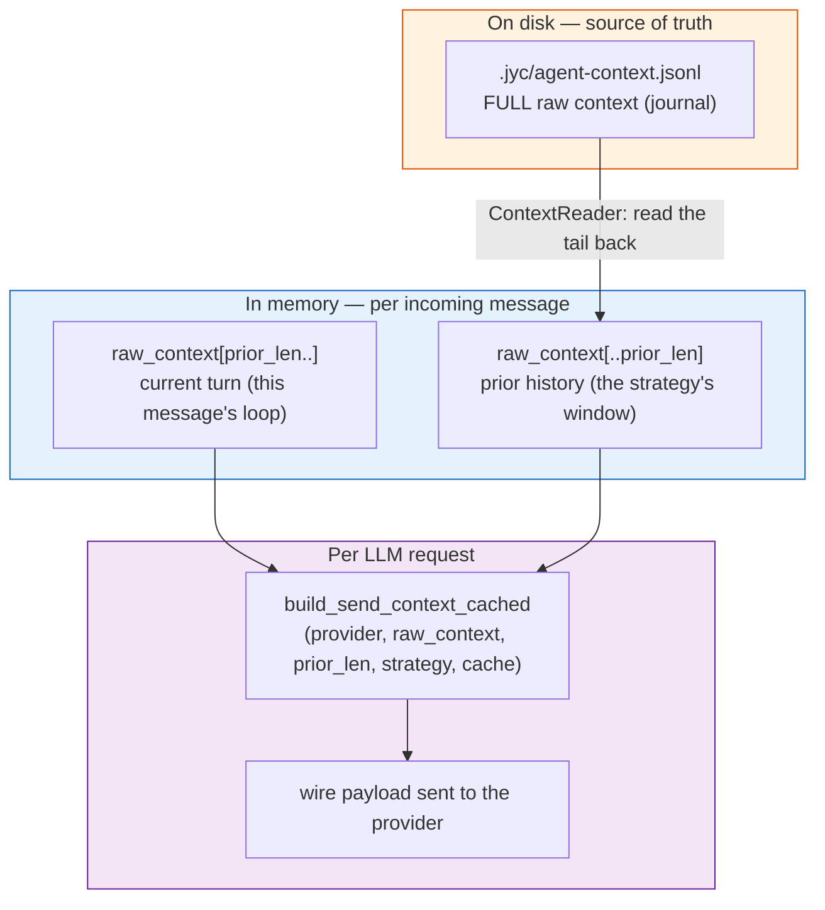
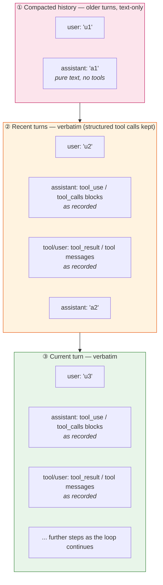

# Context Management

How JYC decides what the LLM sees on each request: context strategies,
turn pairing, tool-call annotations, and the token-level safety nets that
prevent context overflow.

## Overview

Three core principles govern the whole system:

1. **The raw context is the source of truth.**
   `.jyc/agent-context.jsonl` (append-only journal, one message per line) stores the full conversation (including tool
   calls and results) exactly as recorded. Strategies never reshape this
   file — only a session reset (manual `/reset`) clears it. The journal
   is read back **backwards, in blocks** (see
   [Reading the prior back](#reading-the-prior-back)): only the window
   the strategy needs is parsed, so a journal that grew to hundreds of
   megabytes costs the same per turn as a small one.
2. **Only the wire payload is shaped.** Every LLM request passes through
   `build_send_context_cached()` (`crates/jyc-agent/src/agent_loop/context.rs`),
   which decides what slice of the raw context to send and in what form.
3. **The strategy keeps the request inside the window.** The sliding
   window is the mechanism that bounds what is sent; there is no
   separate token monitor that compresses or resets the session
   underneath it (those layers were removed — the window never let the
   context grow past the model's limit in the first place).
4. **The system prompt is unchanged by runtime churn; volatile state
   rides the turn.** Every LLM call re-sends the whole prefix, and
   providers that cache by prefix only reuse what did not change, so the
   system prompt holds only content that changes when config or files do
   — the one exception being the access boundary's grant lines, which
   have to track what the tool layer enforces. Runtime state that moves
   while the instance runs — the subagent roster and the channel/topic
   roster — is built by `build_turn_reference()`
   (`crates/jyc-agent/src/service/prompt.rs`) and prepended to the
   current turn's user message inside a `<runtime-state>` block, framed
   as an auto-generated snapshot. That block sits past the cached
   prefix either way (the user message is new every turn), so topics
   appearing and closing no longer invalidate the system prompt's cache
   entry. The per-turn `prompt_hash` on the `System prompt built` trace
   line is the regression tripwire. Layout diagrams:
   [DESIGN.md §8](../../DESIGN.md).

## Data Plane



`prior_len` is the length of the raw context at the moment the incoming
message was received. Everything after it — the new user message, the
assistant's intermediate steps, tool calls, tool results — is the
**current turn**, which is always sent verbatim so tool_use/tool_result
pairing stays valid mid-loop.

### Reading the prior back

`crates/jyc-agent/src/context_reader.rs` owns the journal's read side.
The journal is append-only, so the reader never needs the whole file: it
walks **backwards** from the end in 64 KB blocks, parses the lines it
finds and hands out the window the caller asked for.

- **The unit is the turn, not the message.** A turn opens at a
  text-bearing user message; a *pair* is a turn that produced an
  assistant reply. The two counts differ (an unanswered user message is
  an opener without a pair), and the strategies read both kinds.
- **The depth comes from the strategy.**
  `agent_loop::context::prior_depth()` turns the config into a
  `PriorDepth`: `sliding_window` asks for the last `window × mult`
  pairs (the region-① block capacity — the block head can sit anywhere
  inside that span) and the last `note_window` openers; `full` mode and
  an unset `note_window` ask for everything.
- **The slice starts at a turn boundary**, so the strategies see the
  same turns they would have seen in the full journal — the payload is
  byte-identical either way (a differential test in
  `agent_loop/context.rs` pins that).
- **Dangling tool calls are repaired on the way out.** The slice drops
  an assistant message whose tool calls have no tool result, and
  everything after it, as the whole-file load path did. The repair
  cannot wait for the wire: there it would also drop the current turn,
  which sits after the dangling message.
- **The pair count stays warm.** The reader keeps how many pairs the
  journal holds in process, keyed by the journal's length and mtime, and
  the writer adds to it as it appends. A turn that changes nothing on
  disk costs a `stat`, not a full count.
- **A torn tail is repaired or dropped.** A crash mid-append can leave a
  partial last line. When it is a complete message that lost only its
  newline — the usual shape, the write was cut at its last byte — it is
  kept, and the next append terminates it. A partial line is dropped
  instead. Either way the history in front of it is untouched: the cut
  point is found by scanning back for the last newline, and an
  unreadable journal (the scan fails) is left alone rather than
  truncated.
- **A corrupt line ends the backward scan**: the newer turns stay, the
  older ones are not trusted. This is the inverse of the whole-file
  parser, which kept the older prefix — with a backwards scan the newer
  turns are the ones already parsed.

The write side is append-only too: a turn's messages are appended at the
end of the file (`session::save_raw_context`), and nothing before them
is touched.

## Context Strategies

Configured via `context_strategy` (see [Configuration](#configuration));
changeable at runtime with the `/context` command.

### `full`

Sends the entire raw context on every request — `build_send_context_cached`
returns `Cow::Borrowed`, a zero-copy borrow. Simple, accurate, and grows
linearly with conversation length until a token safety net fires.
Not the default — opt in via `context_strategy = { mode = "full" }`.

### `sliding_window`

Sends three parts, in order. Let `recent` = the count of completed
prior turns placed in the verbatim region ② — `recent =
min(note_window, pairs_in_prior)` when `note_window` is set, `recent =
pairs_in_prior` when unset (the implementation in
`build_send_context_cached`
computes this via `verbatim_start_index` + `extract_pairs(...).len()`):

1. **Compacted history** — the pairs from the **block head** up to the
   verbatim region, reduced to pure text and reformatted in the active
   provider's wire format. The head is block-anchored (below): it stays
   put while the block holds `window × mult` pairs or fewer, so within
   a block this region only *appends* one pair per turn and its wire
   prefix is byte-stable across turns (prompt-cache friendly).
2. **Recent turns, verbatim** — the last `recent` prior turns with
   their **structured `tool_calls` / `tool_use` and tool results
   intact**, passed through untouched.
3. **Current turn, verbatim** — `raw_context[prior_len..]`, untouched.



② shows a single turn for brevity; in practice it holds up to
`note_window` completed prior turns (default `3`), and ① absorbs the
pairs before it, from the block head onward.

#### The region-① block anchor

Region ① is **block-anchored** so its wire prefix stays stable across
turns. The head position persists across turns as two FNV-1a hashes
(block-head pair's user/assistant text) in
`agent-session.json` (`SessionState.history_block_anchor`) — same file,
same lifecycle: `/reset` and `/new` delete it together with the journal
acknowledgement, which is exactly when an anchor must be dropped.

- **Within a block** the head does not move: each turn only *appends*
  one pair at the region's tail, so the bytes before it are identical
  to last turn's — the provider's prefix cache keeps hitting.
- **Jump.** When the block outgrows `window × mult` pairs (capacity
  `round(window × mult)`, landing floor `round(window × min(mult, 1))`),
  the head jumps forward so the block lands on `max(floor, capacity −
  floor + 1)` pairs. One turn in `window × (mult − 1) + 1` breaks the
  prefix; the rest hit the cache. `mult = 1` makes the landing equal
  the capacity — a constant-size block that slides one pair every turn
  (the pre-block behavior); fractional `mult` (e.g. `0.5`) shrinks the
  block below a window (constant size, sliding every turn).
- **Cold rebuild.** When the anchor is absent (fresh session, or a
  session file written before the field existed) or its pair is no
  longer in the delivered slice (journal rewritten, window/mult
  changed beyond the reader depth), the block rebuilds from the last
  `capacity` pairs and re-anchors. All paths converge to the same
  state for the same journal and config.
- The reader depth `window × mult + note_window` guarantees the
  anchored head is always inside the delivered slice for a
  journal-consistent session: the block never exceeds the capacity and
  the verbatim region is the openers on top.

① and ② are built **once per turn**, not once per LLM call: they depend
only on `raw_context[..prior_len]`, which is fixed while a turn runs
(injections append after it; the one shrink — a cancellation truncation —
ends the turn). `SendContextCache` (keyed on that split point) holds
them for the turn's remaining calls; the log's `history_rebuilt` says
whether a call rebuilt them (`rebuilt`), reused them (`reused`), or built
nothing at all (`-`, `full` mode).

Why the split: the recent turns and the current turn are mid-flight tool
activity, so their `tool_use` ↔ `tool_result` structure must stay legally
paired or the provider API rejects the request outright. **Keeping the
recent turns' structured tool calls in the wire format the model is
supposed to emit also stops the thinking-content leak**: folding tool
calls into user-role *text* notes taught thinking models (MiniMax,
DeepSeek) to write their process — tool calls and action announcements —
as content instead of using the structured channel, which then leaked
"thinking" into delivered replies. Older turns are compacted to text-only
to bound the window size.

#### Turn pairing (`extract_pairs`, `crates/jyc-agent/src/session.rs`)

The pairing unit is the **turn**, not the single message:

- A **text-bearing user message opens a turn**; the next one (or end of
  context) closes it.
- **All assistant messages in a turn are merged into one entry** holding
  only their text — intermediate tool-call steps and the final reply
  alike. `reasoning_content` and `tool_calls` are stripped from the
  assistant entry.
- **The turn's tool calls fold into a separate user-role history note**
  (see below), never into the assistant's own text.
- **Anthropic `tool_result` user-role wrappers** carry no text, so they
  don't open turns; they only feed the results map.
- **Round-tripped history notes are skipped** on re-parse — they are
  metadata, not turn boundaries, so a compacted-then-reparsed context
  stays stable.
- Assistant messages seen before any user message are dropped; a trailing
  turn with no assistant reply yet produces no pair (a fallback keeps the
  last user message when no pairs exist at all).

#### History notes

History notes are the **storage** representation of a turn's tool calls
(written to the stored context). The sliding-window **wire payload no
longer emits them** — the most recent `note_window` turns are sent verbatim with their
structured tool calls, and older turns compact to text-only; round-tripped
notes are filtered out before sending.

Each turn with tool calls gets one user-role message emitted **before**
the assistant text (so no `assistant → user(note)` adjacency sits
right before the next real user turn — which would prime the model
to treat the note as a fresh instruction):

```
[History note] assistant tool calls: bash(command="ls -la") → ok, read(file_path="a.txt") → [error] No such file
```

- Results are matched to calls by id (OpenAI `tool_call_id` / Anthropic
  `tool_use_id`) within a **turn-scoped map**, so an id reused in a later
  turn can never misattach to an earlier call.
- Failed calls are prefixed `[error] `.
- Legacy `jyc_reply_message` calls (from transcripts persisted before the
  tool was removed) are excluded. The reply text was already delivered to
  the user and needs no replay into model context. A turn that contained
  only such calls emits no note at all.
- The assistant's own text stays pure — models were observed mimicking
  the older in-text annotation format and emitting fake tool-call text as
  their reply; the system prompt's "History Format" section states the
  contract explicitly.

Size caps (constants in `session.rs`):

| Limit | Value | Notes |
|-------|-------|-------|
| Single argument value | 200 bytes | truncated with `… [truncated N bytes]` |
| Single tool result | 500 bytes | full result is one `context_browse` away |
| **Whole note** | **2000 bytes** | overflow folds to `…(N more calls)` |

With the default `window = 10`, all notes together cost at most ~20 KB of
bytes. The dominant factor in window size is the untruncated
user/assistant text itself, not the notes.

**`note_window` (optional)** sizes the verbatim region ②: when set to
`M`, the last `min(M, pairs_in_prior)` prior turns keep their structured
`tool_calls` / `tool_use` and tool results intact; older turns in the
window compact to text-only. Boundary cases (matching
`verbatim_start_index` + `build_send_context_cached`):

- **Unset** — the entire prior becomes verbatim and `window`
  is effectively ignored. The implementation substitutes
  `usize::MAX`, so `verbatim_start_index` finds no `M`-th turn and
  returns 0. To get a `window`-bounded prior, set `note_window`
  explicitly.
- **`M = 0`** — pure text window; the entire prior is compacted, last
  `window` pairs kept as text-only.
- **`0 < M ≤ window`, prior ≥ `M`** — last `M` prior turns verbatim;
  older turns compacted to last `window − M` pairs as text-only.
- **`M > window`, prior ≥ `M`** — verbatim region exceeds `window` and
  ① shrinks to 0. **There is no clamp** — `compact_keep =
  window.saturating_sub(verbatim_pairs)` only prevents the compact
  region from going negative, never the verbatim region from growing.
  To bound the prior to `window`, set `M ≤ window`.
- **`0 < M`, prior < `M`** — `recent = pairs_in_prior`; the entire
  prior becomes verbatim (`compact_prior` is empty because
  `verbatim_start_index` returns 0) and ① is empty regardless of
  `window`.

Rationale: the recent turns are "what just happened / what just failed",
and showing them in the structured wire format keeps the model anchored to
the tool-calling channel it is supposed to use. (This replaces the earlier
behavior where recent turns carried a **user-role text history note**
summarizing their tool calls — text notes taught thinking models to write
their process as content instead, leaking thinking into replies.)

Trade-off: an older compacted turn loses tool-error visibility — the model
may re-run a command that failed there; `context_browse` remains the
fallback for recovering the original calls. History notes stay in the
stored context — `note_window` only shapes the sliding-window wire
payload, and round-tripped notes are filtered out before the payload is
sent.

#### Anthropic compatibility defenses

- Synthetic user/assistant messages are built via the active provider's
  own formatter (`format_user_message` / `build_raw_assistant_message`),
  so both `content: "..."` (OpenAI-compat) and `content: [...]`
  (Anthropic) shapes stay valid.
- **Empty text blocks are never emitted** — messages with no extractable
  text are skipped, because Anthropic rejects empty blocks, especially
  under `cache_control`.
- **A journal written on another provider is normalized before it is
  sent.** The journal stores the *active* provider's wire format, so after
  a `/model` switch the history still holds the other family's messages.
  Both send paths convert them: `openai_compat` / `openai_responses` call
  `anthropic_to_chat_messages`, and `AnthropicProvider::complete_raw`
  calls `chat_to_anthropic_messages` (`tool_calls` → `tool_use` blocks,
  `role:"tool"` → a `tool_result` block in a user turn, chat text/image
  parts → `text`/`image` blocks, `reasoning_content` dropped, empty
  content dropped). Without the second direction a topic switched from an
  OpenAI-family model could not answer at all: the Messages API rejects
  `tool_calls` / `role:"tool"` outright (`messages.N … INVALID_REQUEST_BODY`).
  Conversion is per request — the journal is never rewritten — and both
  directions leave messages already in the target shape untouched, so a
  journal that switched back and forth stays valid.

## Debug dump: `/context dump on|off`

For inspecting what the model actually sees — useful when a model
"hallucinated a tool call I never made" or when a windowing decision
seems off — every LLM call in a topic can be appended as one JSON line
to:

```
<topic_path>/.jyc/wire-payload.jsonl
```

Toggle with the `/context` command:

| Command | Effect |
|---------|--------|
| `/context dump on` | Write `.jyc/wire-payload-dump.json` flag; dump starts on next LLM call |
| `/context dump off` | Remove the flag; no further dumps |
| `/context dump` | Show current state + dump file path |

Each line of `wire-payload.jsonl` is one JSON object:

```json
{
  "ts": "2026-08-24T12:34:56.789Z",
  "iter": 3,
  "strategy": { "mode": "sliding_window", "window": 10, "note_window": 3 },
  "regions": [1, 1, 2, 2, 3],
  "wire_payload": [ ... ]
}
```

`regions` is a parallel `Vec<u8>` to `wire_payload`: `1` = compacted
history, `2` = verbatim prior, `3` = current turn. `1` for `Full` mode
means "single region, no windowing". Use it to partition the payload
when reconstructing what each LLM call looked like.

**Bounded footprint.** The file is capped at the **last 50 lines**
(oldest dropped). For a 12-message payload at ~10 KB per call this
stays under ~500 KB even across many iterations — small enough to
diff between iterations with `git diff` or pipe through `jq`.

The flag file (`wire-payload-dump.json`) survives `/reset`, `/new`, and
`/close` — disable it explicitly when you're done. Best-effort IO:
write errors are logged at `warn` and never propagated (a broken dump
must not break the agent loop).

For an in-process, human-readable view of a single wire payload (with
ASCII boxes per region), call `dump_send_context` from a test or via
the `crates/jyc-agent/src/agent_loop/context.rs` API. It uses the same
`build_send_context_with_regions` (a cold build: it delegates to
`build_send_context_cached` with a throwaway cache) so the labels are
identical.

## Recovering dropped turns: `context_browse`

Turns that fall out of the window are not gone — they remain in the
journal on disk. The built-in `context_browse` tool pages through the
full transcript (shared `extract_pairs` view):

- `offset` — pairs to skip from the **newest** end (0 = most recent).
- `limit` — page size (default 10, max 50).
- Returns numbered `USER:` / `ASSISTANT:` lines, oldest→newest within the
  page.
- Reads the older turns back from the journal (the reader parses only
  the tail the page needs) and takes the running turn from memory —
  the journal does not have it yet.

The system prompt tells the agent to use `context_browse` whenever it
needs earlier turns of the current conversation.

## Token safety nets

The sliding window is the safety net: it shapes every request so the
context the model sees stays inside the model's context window. There is
no second layer underneath it — no mid-loop compaction, no auto-reset, no
reset-compression mode. A session reset (`/reset`) clears the context
outright; it does not summarize or compact it.

The context-window figures the dashboard and `/info` show come from the
same place: the most recent LLM call's `usage.input_tokens` plus that
call's `usage.output_tokens` — the size of the context the *next* call
will carry — against the model's context window.

## Configuration

```toml
# Global default for all channels/topics
[ai]
context_strategy = { mode = "sliding_window", window = 10, note_window = 3, tool_result_cap = 2048 }

# Per-pattern override (takes priority over [ai])
[channels.jyc_repo.patterns."**"]
context_strategy = { mode = "full" }
```

`mode` accepts `full` or `sliding_window` (alias `sliding`; default).
`window` counts **turns**, not messages or tokens. `note_window` is
optional (unset = entire prior verbatim, `window` ignored; `0` = pure
text window of the last `window` pairs) — see `note_window` above for
the full boundary table. `tool_result_cap` is a per-tool-result byte
cap on the verbatim region — see below.

### Verbatim tool-result cap (`tool_result_cap`)

`sliding_window` mode sends the most recent `note_window` prior turns
verbatim, plus the full current turn. Both regions can hold very large
tool results (`read` of a 1000-line file, `bash` test output, etc.) —
the verbatim region can balloon quickly when a single user input
spawns many tool calls.

`tool_result_cap: N` caps each tool result in region ② (the verbatim
prior region) at `N` bytes, suffixed with the standard `… [truncated N bytes]`
marker (same format as the existing compaction truncation, so the model
sees consistent truncation across all boundaries). Region ③ (the current
turn) is untouched by it — see `turn_tool_result_cap` below. Only
string content is capped:

- OpenAI / simple wire format (`role: "tool"`, string `content`) —
  the string is truncated in place.
- Anthropic wire format (`role: "user"` with `[tool_result]` blocks) —
  each `tool_result` block's string `content` is truncated; non-tool
  blocks (text/image) and block-level array `content` pass through.

Non-tool messages (assistant / user with no `tool_result` blocks) are
untouched. The compacted region ① is also untouched — it's text-only
user/assistant pairs, no tool results to cap.

| Value | Behavior |
|-------|----------|
| unset / absent | Every tool result is sent in full. |
| `Some(0)` | Explicit "off" sentinel — same as unset. |
| `Some(N > 0)` | Cap each tool result in region ② (verbatim prior) at `N` bytes. Region ③ is governed by `turn_tool_result_cap`. Default `2048`. |

**Resolution layer:** follows the same chain as the rest of
`ContextStrategyConfig` (override file → matched pattern → first
pattern → `[ai]` → built-in default). The CLI arg
`/context sliding N M CAP` sets the third positional; absent means
"use configured". "Configured" here is the config part of that chain
only (`config.toml` → pattern → `[ai]`): an absent slot does *not* pick
up a value an earlier `/context` call wrote into the override file,
even though that file still governs the turn itself. The CLI enforces
`0 ≤ CAP ≤ 1 MiB`; larger caps must go through `config.toml` or
`.jyc/context-strategy.json`.

## `turn_tool_result_cap` — bounding region ③

Region ③ is uncapped by default: the model is mid-reasoning over those
tool results, and silently trimming what it is still working through is
the more damaging failure. The cost is that one verbose result — a
`read` of a large file, a chatty command — rides every remaining call
of the turn, at full price each time.

`turn_tool_result_cap: N` opts into a bound on region ③. An oversized
result keeps its **head and tail** with the middle replaced by

```
… [N bytes dropped from the middle — re-read with offset/limit to see the gap] …
```

Head-only truncation would hide what a result is usually read for: the
error at the bottom of a command's output, the totals of a grep. The
marker states how much is missing and how to page it, so the cost of
the cut is one extra tool call the model chooses to make. Unlike
`tool_result_cap`, whose marker sits on top of `N`, this cap counts the
marker **inside** `N` — the caller gets the byte bound it asked for.

| Value | Behavior |
|-------|----------|
| unset (default) | Region ③ sent in full. |
| `Some(0)` | Explicit "off" sentinel — same as unset. |
| `Some(N > 0)` | Each region ③ tool result keeps head + tail within `N` bytes total. Below ~128 bytes there is no room for both ends, so it degrades to the plain head-only cut. |

Both wire shapes are handled exactly as for `tool_result_cap` (string
`content` in place, or per-`tool_result`-block for Anthropic), and the
cap is per result block, not per turn — a turn with ten tool calls can
still exceed `N` in total.

Set it from a command: `/context sliding 10 5 2048 32768` (fourth
positional; `0` switches it off, omitting it keeps the configured
value, ceiling 1 MiB), or from config as
`context_strategy = { …, turn_tool_result_cap = 32768 }`.

**Interplay with `note_window`:** the cap only applies to messages in
the verbatim region. If `note_window = 0` (text-only window) or
`mode = "full"`, no tool results reach the wire verbatim, so the cap
is a no-op even when set.

**Why per-result, not global:** a single 5 KB `read` result is usually
fine; ten 100 KB results from one bash test suite are the actual
problem. Capping per-result gives both levers — keep individual
results readable while bounding the total. A global token budget on
the wire payload is a separate concern (`max_history_tokens`).

## `max_history_tokens` — bounding regions ① + ② by weight

`window` counts turns, so the same `window = 10` costs 2k tokens on a
quiet topic and 200k on one whose turns carry megabyte-sized tool
results. `max_history_tokens` is the second, orthogonal lever: it caps
what the two history regions weigh **together**, not how many turns
they hold.

```toml
context_strategy = { …, max_history_tokens = 30000 }
```

When the estimate is over budget the oldest history goes first:

1. Region ① sheds its oldest messages. The leading history marker
   survives — it is what explains the text-only block.
2. Region ② sheds its oldest **whole** turns. Whole turns are the unit
   because a partial cut leaves a tool result whose `tool_use` is gone,
   which providers reject.

Region ③ is never part of the budget: it is the turn in flight, and
`turn_tool_result_cap` is its lever. A budget smaller than the marker
alone still sends the marker — that is the floor region ① trims to.

**The estimate is heuristic, not a tokenizer.** CJK characters count one
token each (a Chinese glyph costs about what a short English word does,
so a plain bytes÷4 estimate undercounts mixed CJK/English transcripts by
a quarter), everything else a quarter token per byte, plus a small
per-message constant. Object keys are ignored. This bounds history
weight — it is not billing, and a few percent of drift is fine for
that.

Set it from a command: `/context sliding 10 5 2048 0 30000` (fifth
positional; `0` switches it off, omitting it keeps the configured value,
ceiling 4M tokens). Unset by default: the windowed history is sent
byte-for-byte as before until you ask for a budget.

**Interplay:** the budget is independent of `window` and
`note_window` — a generous budget changes nothing about which turns are
verbatim, it only bounds how much of the history survives when the
weight runs away.

**Resolution chain** (highest wins):

1. Runtime override `.jyc/context-strategy.json` (written by `/context`)
2. The topic's own `[context_strategy]` — a subagent type is expanded into the
   child's `.jyc/config.toml` at spawn time, so this is how a role starts small
3. Matched pattern's `context_strategy` (or synthesized `[agents.<name>]`)
4. First pattern fallback
5. Global `[ai].context_strategy`
6. Built-in default: `sliding_window` / `window = 10` / `note_window = 3` / `tool_result_cap = 2048` / `max_history_tokens` unset

**Runtime commands:**

| Command | Effect |
|---------|--------|
| `/context` | Show current strategy and its source (`override` / `default`) |
| `/context full` | Send the full context |
| `/context sliding [N] [M] [CAP] [TURNCAP] [MAXHIST]` | Sliding window, N turns (default 10, max 200); M = note window (default 3, max 200); CAP = tool-result byte cap on verbatim region (0..1 MiB, default 2048); TURNCAP = same for the current turn (0..1 MiB, unset by default); MAXHIST = token budget for regions ① + ② (0..4M, unset by default). An absent slot falls back to the configured value; `0` switches a cap off |
| `/context reset` | Remove the runtime override, revert to configured default |

## Code map

| Component | Location |
|-----------|----------|
| Wire payload shaping (`build_send_context_cached`, its `SendContextCache`, `dump_send_context`, `cap_tool_result_content`) | `crates/jyc-agent/src/agent_loop/context.rs` |
| How much prior the strategy reads (`prior_depth`) | `crates/jyc-agent/src/agent_loop/context.rs` |
| Reading the prior back from the journal (`ContextReader`, block scan, parsed tail) | `crates/jyc-agent/src/context_reader.rs` |
| Turn pairing, history notes, truncation caps (`extract_pairs`, `flush_turn`) | `crates/jyc-agent/src/session.rs` |
| Journal writes (`save_raw_context`) | `crates/jyc-agent/src/session.rs` |
| Wire-payload dump persistence (`read_wire_payload_dump_enabled`, `append_wire_payload_dump`) | `crates/jyc-agent/src/session.rs` |
| Agent loop iteration (calls `build_send_context_cached`, triggers dump) | `crates/jyc-agent/src/agent_loop/mod.rs` |
| Strategy resolution, pre-loop pre-check | `crates/jyc-agent/src/service/mod.rs` |
| System-prompt guidance (History Format, Chat History sections) | `crates/jyc-agent/src/service/prompt.rs` |
| `context_browse` tool | `crates/jyc-agent/src/tools/builtin/context_browse.rs` |
| `/context` command (incl. `dump on\|off` subcommand) | `crates/jyc-core/src/command/context_handler.rs` |
| Override persistence (`context-strategy.json`) | `crates/jyc-core/src/session_state.rs` |
| `ContextStrategy(Config)`, `ResetCompressionConfig` types | `crates/jyc-types/src/channel.rs` |

## History

Key changes, newest first (see CHANGELOG.md for full entries):

- **system prompt stability** — the subagent roster and the channel/topic
  roster left the system prompt for a `<runtime-state>` block on the
  turn's user message, so topic churn no longer invalidates the cached
  prefix; `prompt_hash` on the `System prompt built` trace line guards it.
- **#651** — recent `note_window` turns are sent **verbatim** (structured
  `tool_calls` + results) instead of user-role text history notes — text
  notes taught thinking models to write their process as content (the
  thinking-content leak). Older turns still compact to text-only.
- **#647** — windowed history-note format clarity: `[History note]`
  is emitted before the assistant text (was after); truncated args
  and results carry an explicit `… [truncated N bytes]` marker (was
  bare `…`); the OpenAI provider's `[SUCCESS] `/`[ERROR] ` prefix is
  stripped from history-note results so failures render as `[error] `
  for both providers.
- **#632** — `note_window`: history notes limited to the most recent M
  windowed turns; `/context sliding [N] [M]`.
- **#630** — history notes moved to separate user-role messages (fixes
  transcript annotation mimicry); silent-reply escape.
- **#629** — synchronous reply delivery, mimicry guard, lost-content
  warning.
- **#628** — turn-based pairing for the sliding window (window counts
  turns, not messages).
- **#627** — history notes include truncated tool results with `[error]`
  markers.
- **#626** — `context_browse` tool + system-prompt guidance for dropped
  turns.
- **#624** — sliding-window strategy, `/context` command,
  `context_strategy` config.
